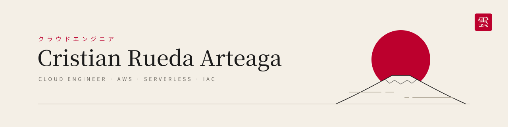

<picture>
  <source media="(prefers-color-scheme: dark)" srcset="assets/banner-dark.svg">
  
</picture>

<b>English</b> · <a href="README.es.md">Español</a>

Cloud engineer focused on **AWS**. I design, build and tear down real infrastructure — and I measure what happens when it breaks.

- 🎓 **Systems Engineering** graduate — Escuela Militar de Ingeniería (EMI), Santa Cruz, Bolivia
- 🏢 Internship at **Sofía Ltda.** as a software developer and data analyst
- 📍 Based in Santa Cruz, Bolivia (UTC−4) · Spanish (native), English (basic, improving)

&nbsp;

### 作品 · Projects

| Project | What it is | Highlights |
|---|---|---|
| [**Loan Collections Platform**](https://github.com/CristianAndres-Arteaga/loan-collections-platform-aws) | Three-tier AWS architecture: VPC across 2 AZs, ALB + EC2 Auto Scaling, RDS PostgreSQL Multi-AZ, ElastiCache, CloudFront + S3. All IaC in CloudFormation | Forced RDS failover: **≤ 15 s** of client errors · PITR drill **RPO 4 min 26 s** · every design decision recorded as an ADR |
| [**Task Management System**](https://github.com/CristianAndres-Arteaga/task-management-system) | Serverless full-stack app: Lambda, API Gateway HTTP API, DynamoDB single-table, Cognito, React + TypeScript. IaC with AWS SAM | Least-privilege IAM · CI/CD through **GitHub Actions + OIDC** (no stored AWS keys) · CloudWatch alarms → SNS · ran inside the free tier |

&nbsp;

### 技術 · Stack

  
   
  

**AWS:** VPC · EC2 / Auto Scaling · ALB · RDS · ElastiCache · S3 · CloudFront · Lambda · API Gateway · DynamoDB · Cognito · CloudWatch · SNS · IAM · KMS
**IaC & delivery:** CloudFormation · AWS SAM · GitHub Actions (OIDC)

&nbsp;

### 現在 · Now

- Preparing the **AWS Certified Solutions Architect – Associate (SAA-C03)** — study notes in [aws-saa-c03-notes](https://github.com/CristianAndres-Arteaga/aws-saa-c03-notes)
- Open to freelance work: static sites on S3 + CloudFront, CI/CD with GitHub Actions + OIDC, serverless APIs, AWS cost & cleanup reviews

&nbsp;

### 連絡 · Contact

&nbsp;

雲 — <i>kumo</i>, "cloud"

